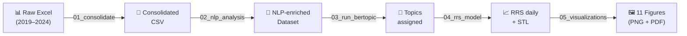

# Reputational Risk Score for INFONAVIT: An NLP Approach

[](https://creativecommons.org/licenses/by/4.0/)
[](https://www.python.org/downloads/)

> **Paper:** *Media Sentiment and Reputational Risk in a Public Mortgage Institution*
>
> Submitted to the *Journal of Risk and Financial Management* (JRFM), manuscript jrfm-4546218.
> This repository reflects the first revision (R1, September 2026).

---

## Overview

This repository contains the code and pre-computed results for a study that
constructs a **Reputational Risk Score (RRS)** for INFONAVIT — Mexico's largest
public housing finance institution — using NLP-based sentiment analysis of
~138,800 media articles spanning November 2019 to July 2024.

The pipeline combines:
- **Multilingual BERT** sentiment classification (`nlptown/bert-base-multilingual-uncased-sentiment`)
- **BERTopic** topic modeling (`paraphrase-multilingual-MiniLM-L12-v2`)
- **STL decomposition** of the composite risk index
- **Crisis detection** via rolling z-scores



---

## Revision R1 (September 2026)

During the first revision we found that `scripts/04_rrs_model.py` (and the
weights in `config.py`) did **not** implement Equations (1)–(5) of the manuscript:
components were min–max normalized, volume used a min–max of counts instead of
the normal CDF, the keyword component used a capped count, the composite was
rescaled to [0, 100] with its own sample min/max, and crisis z-scores used a
centered (not trailing) window. Scripts `06`–`08` implement the published
equations and produce every number, table and figure of the revised manuscript.
`04_rrs_model.py` and `05_visualizations.py` are kept only as a record of the
original submission.

What the corrected pipeline does:

- **C1** = (1 − mean BERT score) / 2, **C2** = Φ((n − μ)/σ), **C3** = share of
  articles labelled *Negativo* by the provider's human coders (`Tono`),
  **C4** = share of headlines containing a crisis keyword; RRS = 100 × (0.35·C1 +
  0.25·C2 + 0.25·C3 + 0.15·C4). No min–max step.
- Crisis lexicon: generic `demanda` replaced by `demanda judicial`, `demandado`,
  `demandan` (Appendix A of the paper).
- Excludes the incomplete provider delivery of 2020-06-01 to 2020-11-30 and keeps
  days with at least 30 articles (sensitivity: 10 and 1).
- Trailing rolling z-score (w = 14, τ = 2, merge gap = 3) plus 48 alternative
  configurations, alternative weights (including PCA), top-20 outlets,
  deduplicated headlines, classifier-drift tests and STL (periods 7 and 30).

```bash
# requires data/infonavit_consolidated.csv and data/infonavit_nlp_results.csv
python scripts/06_rrs_corrected.py      # corrected RRS + robustness report (~5 s)
python scripts/07_revision_numbers.py   # every number reported in the revised manuscript
python scripts/08_figures_revision.py   # Figures 1–7 of the revised manuscript
```

Outputs: `results/revision_r1/` (report `resultados_robustez.md`,
`revision_numbers.json`, daily series, episodes, grids) and
`figures/revision_r1/` (300 dpi PNG).

---

## Repository Structure

```
├── config.py                  # Centralized paths, model params, RRS weights
├── requirements.txt           # Python dependencies
├── LICENSE                    # CC-BY-4.0
│
├── scripts/
│   ├── 01_consolidate_data.py # Phase 1 — merge & clean 6 Excel files
│   ├── 02_nlp_analysis.py     # Phase 2 — BERT sentiment + metrics
│   ├── 03_run_bertopic.py     # Phase 2b — topic modeling
│   ├── 04_rrs_model.py        # Original submission (superseded, see Revision R1)
│   ├── 05_visualizations.py   # Original submission figures (superseded)
│   ├── 06_rrs_corrected.py    # R1 — RRS as in Eqs. (1)–(5) + robustness
│   ├── 07_revision_numbers.py # R1 — all figures quoted in the revised paper
│   └── 08_figures_revision.py # R1 — Figures 1–7 of the revised paper
│
├── data/
│   └── raw/
│       └── README.md          # Description of raw data & how to obtain it
│
├── results/                   # Pre-computed intermediate outputs
│   ├── revision_r1/           # R1 outputs (corrected RRS, robustness)
│   ├── rrs_summary.json       # RRS descriptive statistics
│   ├── rrs_daily.csv          # Daily RRS time series
│   ├── rrs_monthly.csv        # Monthly RRS averages
│   ├── rrs_weekly.csv         # Weekly RRS averages
│   ├── rrs_stl_decomposition.csv
│   ├── crisis_days.csv        # Detected crisis episodes
│   ├── correlation_matrix.csv
│   ├── sentiment_comparison_metrics.json
│   ├── bertopic_topics.csv
│   ├── topic_details.json
│   ├── topic_sentiment_cross.csv
│   ├── monthly_tone_distribution.csv
│   ├── monthly_nlp_distribution.csv
│   ├── nlp_sentiment_by_type.csv
│   ├── sentiment_by_type.csv
│   ├── sentiment_by_medio.csv
│   ├── sentiment_by_state.csv
│   ├── top_medios.csv
│   └── top_temas.csv
│
└── figures/                   # Publication-quality figures
    ├── revision_r1/           # R1 figures (corrected RRS)
    ├── fig1_rrs_timeseries.png
    ├── fig2_sentiment_distribution.png
    ├── fig3_confusion_matrix.png
    ├── fig4_heatmap_type_year.png
    ├── fig5_topics_sentiment.png
    ├── fig6_wordclouds.png
    ├── fig7_rrs_monthly.png
    ├── fig8_stl_decomposition.png
    ├── fig9_geographic_distribution.png
    ├── fig10_violin_nlp_scores.png
    └── fig11_correlation_matrix.png
```

---

## Key Results (revised manuscript, R1)

| Metric | Value |
|--------|-------|
| Total articles | 138,789 |
| Date range | Nov 2019 – Jul 2024 |
| Unique media outlets | 9,495 |
| Days in the index (≥ 30 articles, 2020-06/11 excluded) | 1,223 |
| Mean RRS (0–100) | 33.06 |
| RRS standard deviation | 6.87 |
| RRS range | 17.92 – 58.68 |
| Crisis days (trailing z > 2) / episodes | 69 / 54 |
| Manual tone (provider): Negative / Neutral / Positive | 2.8% / 61.5% / 35.7% |
| BERT: Negative / Neutral / Positive | 55.8% / 6.2% / 38.0% |

### RRS Weights

| Component | Weight | Definition |
|-----------|--------|-------------|
| Sentiment risk C1 (α) | 0.35 | (1 − mean BERT score) / 2 |
| Volume anomaly C2 (β) | 0.25 | Φ((n − μ) / σ) of daily article count |
| Negativity ratio C3 (γ) | 0.25 | Share of articles with manual tone *Negativo* |
| Crisis keywords C4 (δ) | 0.15 | Share of headlines with a crisis keyword |

---

## Reproducing the Analysis

### Requirements

- Python 3.10 or higher
- ~16 GB RAM (for BERT inference and BERTopic)
- ~10 GB disk (for model downloads)

### Installation

```bash
git clone https://github.com/AnaJZP/infonavit-sentiment.git
cd infonavit-sentiment
pip install -r requirements.txt
```

### Full Pipeline (requires raw data)

Place the six Excel files in `data/raw/` (see [`data/raw/README.md`](data/raw/README.md)
for file descriptions), then run:

```bash
python scripts/01_consolidate_data.py   # ~2 min
python scripts/02_nlp_analysis.py       # ~30 min (CPU)
python scripts/03_run_bertopic.py       # ~45 min (CPU)
python scripts/04_rrs_model.py          # ~1 min
python scripts/05_visualizations.py     # ~2 min
```

### Partial Reproduction (from pre-computed results)

The `results/` directory contains all intermediate outputs. You can:

1. **Verify RRS computations** — Inspect `results/rrs_daily.csv` and
   `results/rrs_summary.json` to confirm the reported statistics.
2. **Regenerate figures** — Run `scripts/05_visualizations.py` using the
   pre-computed CSVs (requires `infonavit_nlp_results.csv`; generate it
   from steps 01–03 or contact the authors).
3. **Inspect topic model** — Review `results/bertopic_topics.csv` and
   `results/topic_details.json` for discovered themes and their
   sentiment distributions.

---

## Models Used

| Model | Task | Source |
|-------|------|--------|
| `nlptown/bert-base-multilingual-uncased-sentiment` | 5-star sentiment → ternary (Neg/Neu/Pos) | [HuggingFace](https://huggingface.co/nlptown/bert-base-multilingual-uncased-sentiment) |
| `paraphrase-multilingual-MiniLM-L12-v2` | Sentence embeddings for BERTopic | [HuggingFace](https://huggingface.co/sentence-transformers/paraphrase-multilingual-MiniLM-L12-v2) |

---

## Citation

If you use this code or data, please cite:

```bibtex
@article{jimenezpreciado2026infonavit,
  title={Media Sentiment and Reputational Risk in a Public Mortgage Institution},
  author={Jim{\'e}nez-Preciado, Ana Lorena and Trejo-Garc{\'i}a, Jos{\'e} Carlos
          and Mart{\'i}nez-Garc{\'i}a, Miguel {\'A}ngel and Venegas-Mart{\'i}nez, Francisco},
  journal={Journal of Risk and Financial Management},
  year={2026},
  note={Under review, manuscript jrfm-4546218}
}
```

---

## License

This work is licensed under [CC BY 4.0](https://creativecommons.org/licenses/by/4.0/).
The raw media monitoring data is proprietary and not distributed with this repository.
